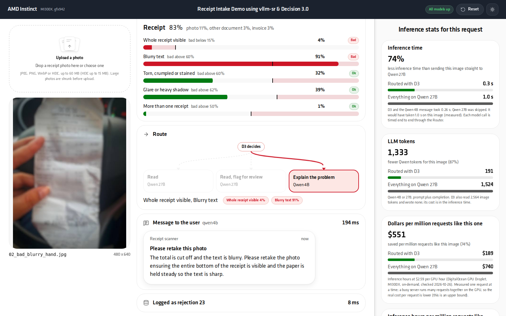
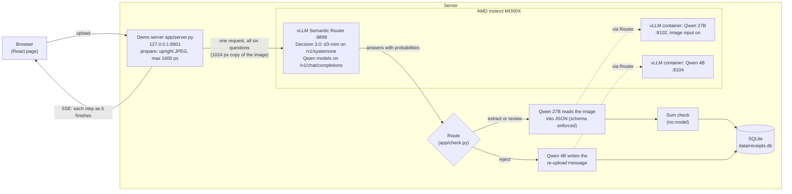

# Receipt validator: vLLM Semantic Router and Decision 3.0 on AMD Instinct

[](https://www.amd.com/en/products/accelerators/instinct.html)
[](https://rocm.docs.amd.com/)
[](https://github.com/vllm-project/semantic-router)
[](https://huggingface.co/vllm-sr/d3-mini)
[](https://github.com/vllm-project/vllm)
[](https://huggingface.co/Qwen)
[](https://www.python.org/)
[](https://react.dev/)
[](https://hub.docker.com/r/vllm/vllm-openai-rocm)

A live demo of what the **[vLLM Semantic Router](https://github.com/vllm-project/semantic-router) (vllm-sr)** and its
**Decision 3.0 (D3)** models add to an LLM application, running on one AMD Instinct MI300X.

A user uploads a photo of a receipt. **D3** (`vllm-sr/d3-mini`, a small decision model served by vllm-sr) looks at it
once and answers six questions in one request, as probabilities: what kind of image is it, is the whole receipt
visible, is it blurry, damaged, covered by glare, or are there several receipts. The app routes on those answers:

- **A good receipt** goes to **Qwen 27B**, which reads it into JSON (store, date, currency, line items, totals). An
  arithmetic check follows and the result goes into SQLite.
- **A bad upload never reaches the 27B.** **Qwen 4B** writes a short message saying what is wrong and how to retake the
  photo, from D3's answers alone (it never sees the image). The user gets a useful answer in about 0.3 s instead of a
  1-1.4 s 27B read of an image it cannot use.

The page shows each step as it happens and compares the routed flow with sending everything to Qwen 27B: inference time
and LLM tokens for the request, and dollars and inference hours per million requests like it.



## What vllm-sr and D3 do here

| Capability | In this demo |
|---|---|
| **One Router for decisions and generation** | D3 is served by vllm-sr next to the two Qwen models. The app calls one endpoint: D3 on `/v1/systemone`, the Qwen models by name on `/v1/chat/completions` (OpenAI-compatible). |
| **Structured decisions, not generated text** | One `/v1/systemone` request carries all six questions: a `choice` question (receipt, invoice, other document, screenshot, photo) and five yes/no (`noul`) statements. D3 returns a probability for each, so the app sets thresholds and a "review" band instead of parsing model output. |
| **Image input** | D3 reads the photo itself. No OCR or separate vision step before the decision. |
| **Fast and small** | D3 answers in one forward pass and generates no tokens: about 50-350 ms for all six questions on the MI300X, against 3-6 s for a 27B read. |
| **Gate before the expensive model** | The decision decides which model runs at all: Qwen 27B only for receipts it can read, Qwen 4B for everything else. That is where the saving comes from. |
| **Probabilities you can tune** | Each check has a borderline and a reject threshold (`CHECKS` in `app/check.py`), tuned on real receipts; see [How it was tuned](#how-it-was-tuned). |

vllm-sr can also choose the model for each request itself (semantic routing with its decision models). This demo keeps
the routing rule in the app on purpose, so every decision and its probabilities are visible on the page.

## Architecture



- **extract**: every check clearly fine. **review**: a check in its borderline band; the 27B still reads it and the row
  is stored with `needs_review = 1`. **reject**: not a receipt, or a check past its threshold.
- All model calls go through vllm-sr: D3 on `/v1/systemone`, the Qwen models by name on `/v1/chat/completions`.
- D3 gets a 1024 px copy of the image (its cost grows with the image's tokens; it decided the same at 1024 px as at full
  size, see [How it was tuned](#how-it-was-tuned)); Qwen 27B reads the 1600 px upload.
- A receipt that fails the sum check (items to subtotal, subtotal plus tax and service to total, a real date, total
  above zero) is also stored with `needs_review = 1`.
- API and event stream: [docs/API.md](docs/API.md). Page: [docs/UI.md](docs/UI.md).

## Requirements

- One AMD Instinct GPU with ROCm and `rocm-smi` working. Measured on an MI300X (192 GB). GPU memory: Qwen 27B takes
  62% of the GPU and Qwen 4B 8% (vLLM `--gpu-memory-utilization`, a share of the whole GPU, mostly KV cache), plus room
  for d3-mini in the Router; `deploy/up.sh` asks for ~158 GiB free on a 192 GB GPU. On a smaller GPU lower
  `GPU_UTIL_27B` (the weights alone are ~52 GB).
- Docker, able to pass `/dev/kfd` and `/dev/dri` to containers. If Docker needs sudo on your host, set
  `DOCKER="sudo docker"` for the deploy scripts.
- Disk: ~75 GB for the models (Qwen 27B ~52 GB, Qwen 4B ~11 GB, d3-mini ~8.5 GB) plus the Docker images
  (`vllm/vllm-openai-rocm:v0.29.0` and the vllm-sr ROCm Router image, pulled on first start).
- Python 3.12 or newer (tested with 3.14; the code itself parses on 3.10). The vllm-sr CLI goes in its own venv; it
  was used with Python 3.12.
- Hugging Face access to download the models. They are not gated today; if one becomes gated, accept its terms on the
  hub and `export HF_TOKEN=...` first.
- Node 18+ only if you change the UI (`ui/`); the built page is committed in `web/`.

## Setup

```bash
# 1. Get the code
git clone https://github.com/madhusoodhans/receipt-validator-demo.git
cd receipt-validator-demo

# 2. Python environment for the demo server (and the hf CLI)
python3 -m venv .venv
.venv/bin/pip install -r requirements.txt

# 3. The vllm-sr CLI (starts the Router in Docker), pinned to the build the demo was made with
python3 -m venv .venv-sr
.venv-sr/bin/pip install --pre vllm-sr==0.5.0.dev20261015074033

# 4. Models: Qwen 27B and 4B into the Hugging Face cache, d3-mini into deploy/models (~75 GB, resumable)
deploy/download_models.sh

# 5. Start everything: the two Qwen containers, the Router, then the demo server (~5-15 min; the first Router start
#    compiles GPU kernels and can take up to ~30 min)
deploy/up.sh                     # DOCKER="sudo docker" deploy/up.sh where Docker needs sudo

# 6. Measure this server's Qwen 27B baseline for the comparison panel (~2 min; once per server)
deploy/measure.sh

# 7. Check it end to end: health, then a good, a borderline and a bad demo image
deploy/smoke_test.sh --reset     # --all runs all 23 demo images
```

`deploy/down.sh` stops what `deploy/up.sh` started (it records that in `deploy/.state`) and leaves anything that was
already running alone; `deploy/down.sh --all` stops the demo's containers and the Router regardless. `deploy/up.sh`
can be run again at any time: parts that are already healthy are kept.

What `deploy/` contains:

| File | What it does |
|---|---|
| `router.yaml` | vllm-sr config: d3-mini on `/v1/systemone`, `qwen27b` and `qwen4b` as vLLM backends reached by container name on the `vllm-sr-network` Docker network, listener on 127.0.0.1:8899. No routing decisions: the demo calls each model by name. |
| `serve_qwen.sh <qwen27b\|qwen4b>` | One vLLM ROCm container (`vllm/vllm-openai-rocm:v0.29.0`), image input on, thinking off, 32k context, port 127.0.0.1:8102 / 8104. Env: `GPU_UTIL`, `GPU`, `HF_HOME`, `DOCKER`, `AITER`, `CPUSET`. |
| `download_models.sh` | `hf download` of the three models. |
| `up.sh` / `down.sh` | Checks (rocm-smi, Docker, free GPU memory, ports, models), start/stop, wait for health, start the demo server. |
| `measure.sh` | `bench/baseline_27b.py` (Qwen 27B on every demo image), then restarts the demo server. |
| `smoke_test.sh` | `/health` must be ok, then demo images through `POST /api/check`, routes checked against `data/demo/labels.json`. Non-zero exit on any failure. |

The Router is started from `deploy/` with
`vllm-sr serve --config router.yaml --platform rocm --minimal --replace-active-config`; vllm-sr keeps its state in
`deploy/.vllm-sr/` and its model cache in `deploy/models/` (both gitignored). vllm-sr runs one Router stack per host
(container `vllm-sr-router-container`); if your host already runs one for something else, `up.sh` stops with a message
instead of replacing it. In that case add d3-mini and the two models from `deploy/router.yaml` to the existing config.

### Why measure on each server

For a rejected image the panel's "everything on Qwen 27B" side is the 27B's measured time and tokens on that same image,
from `data/demo/baseline.json`. That depends on the GPU, the vLLM version and settings. The file in the repo was
measured on our MI300X and records the GPU it was measured on; when that does not match the GPU the server runs on,
the page shows a warning. `deploy/measure.sh` re-measures it (about 2 minutes; do not present while it runs). Uploads
that are rejected get their 27B time measured in the background after the run.

## Open it from a laptop

The demo server, the Router and the vLLM servers all listen on 127.0.0.1 only. Use an SSH tunnel:

```bash
ssh -L 8601:localhost:8601 user@your-gpu-server
```

then open <http://localhost:8601> in the laptop's browser. The page uses no external resources, so it also works on a
network without internet access.

## Presenting the demo

A five-minute walk-through. Before the audience arrives: run `deploy/smoke_test.sh --reset`, open the page, and check
that the health badge in the top bar is green (hover it to see each part).

1. **Reset** (top bar) so the tables and counters start empty.
2. **Click a good receipt** (for example the Swiss hotel bar receipt). Say what happens as the steps appear:
   - **This is the vllm-sr / D3 moment.** D3, served by the Router, answers all six questions in one request in a few
     hundred milliseconds, without generating text. Each bar is a probability; the marker is the threshold; the tinted
     zone is "bad". The app routes on these numbers.
   - The route is **extract**, so Qwen 27B reads the image into JSON (a few seconds). The fields come from a fixed JSON
     schema, so the output always parses.
   - The sum check runs without a model: items add up to the subtotal, subtotal plus tax to the total. The row goes
     into the database.
3. **Click a bad image** (for example the blurry receipt held in a hand):
   - D3 flags it (blurry text), the route is **reject**, and Qwen 4B writes the message the user would see, in well
     under a second. The 27B is never called for this image: the decision model kept the expensive model out of it.
   - Point at the side panel: for this image the routed flow cost D3 plus a small 4B call, against a full 27B read.
4. **Play all** (~90 s for the 23 images, alternating good and bad, with two borderline receipts that are read and
   flagged for review). The panel now sums the whole run.
5. **Upload a phone photo** of a real receipt (or of something that is not a receipt). Photos straight from a phone
   work: HEIC, sideways EXIF orientation and 24 MP images are handled.

Reading the numbers honestly:

- **Inference time** is end to end per model call, measured at the server (request sent to answer received), one
  request at a time. For a rejected image the 27B side is the 27B's measured time on that same image.
- **LLM tokens** count what the Qwen models read and wrote. They leave out D3's image tokens: D3 encodes the image at a
  higher token count, but it is a much smaller model that answers in one forward pass without generating text.
- **Dollars and inference hours per million requests like this one** are this request's inference time times one
  million, priced at a cloud on-demand GPU hour (`GPU_USD_PER_HOUR`; the page shows the price and its source). They
  are measured one request at a time. A busy server runs many requests together on the GPU, so the real cost per
  request is lower: read them as an upper bound, and as the ratio between the two flows. See
  [At full load](#at-full-load) for what we measured under load.
- The saving depends on the share of bad uploads: with no bad uploads, routing adds the cost of D3 to every request
  and saves nothing; the more bad uploads, the more 27B reads it avoids. Play all has 9 bad images out of 23.
- The demo set is 23 images. That is enough to show the flow, not to claim an accuracy figure.

## Supported inputs

- JPEG, PNG, WebP and HEIC (HEIC needs `pillow-heif`, installed by `requirements.txt`), up to 15 MB.
- Phone photos are shrunk before the models see them (in the browser where supported, and on the server): the server
  turns uploads into one upright JPEG of at most 1600 px on the long side (`prepare_upload` in `app/server.py`). An
  iPhone receipt photo read the same at 1600 px as at full size, with the 27B 2.3x faster.
- D3 gets its own 1024 px copy of the upload (`D3_LONG_SIDE` in `app/check.py`).
- Small images (short side under 1000 px) are upscaled for the 27B so their text covers more vision patches.
- Very long receipts (over about 60 items) are refused with a clear error: the 27B's output would exceed its token
  limit.
- One upload is processed at a time; a second one waits for the first.

## Configuration

Environment variables of the demo server (`app/server.py`, also honoured by `start_server.sh` and `deploy/*.sh`):

| Variable | Default | Meaning |
|---|---|---|
| `ROUTER_URL` | `http://localhost:8899` | The vllm-sr Router (D3 and both Qwen models are called through it). |
| `HOST` | `127.0.0.1` | Address the demo server listens on. Keep it on loopback and use an SSH tunnel. |
| `PORT` | `8601` | Port of the demo server. |
| `DB` | `data/receipts.db` | SQLite file; created on start if missing. |
| `GPU_USD_PER_HOUR` | 2.59 | Price of one GPU hour for the dollar figures. The default is DigitalOcean's on-demand MI300X GPU Droplet price per GPU (checked 2026-10-26, set in `app/server.py`); the page shows the price and its source. Set your own cloud's price. |

`GET /health` (the badge in the top bar) probes each part through `ROUTER_URL` the way the pipeline calls it: the
Router, D3 and both Qwen models (the 27B with a tiny image, so it also catches a 27B started without image input).

Deploy script variables: `DOCKER` (default `docker`), `VLLM_SR` (default `.venv-sr/bin/vllm-sr`), `GPU` (GPU index,
default 0), `HF_HOME` (default `$HOME/.cache/huggingface`), `GPU_UTIL_27B` / `GPU_UTIL_4B` (default 0.62 / 0.08),
`HF_TOKEN` (only if a model is gated).

## Troubleshooting

- **Health badge is not green.** Hover it: it names the part that is down (`router`, `d3`, `qwen27b`, `qwen4b`) with the error. Check that
  container with `docker logs rid-qwen27b` / `docker logs rid-qwen4b`, or `.venv-sr/bin/vllm-sr status` and
  `.venv-sr/bin/vllm-sr logs` for the Router (run them from `deploy/`). The demo server's own log is
  `logs/server.log`.
- **"Vision off on Qwen 27B".** The 27B container was started without image input (`--language-model-only`). Restart
  it with `deploy/serve_qwen.sh qwen27b`.
- **Large photos.** The Router refuses images over 8 MB or 16 MP. The server's resize keeps uploads well under both, so
  this only shows up if you call the Router yourself.
- **Port in use.** `up.sh` stops if 8102, 8104 or 8899 is taken by something that is not a healthy demo service.
  `start_server.sh` replaces whatever listens on `$PORT`; set `PORT` to use another one.
- **"Measured on a different GPU" warning.** The numbers in `data/demo/*.json` came from another GPU. Run
  `deploy/measure.sh` on this server.
- **Not enough GPU memory.** Stop other GPU work, or lower `GPU_UTIL_27B` (less KV cache; fine for one user at a time).
- **Router fails at start with a permission error under `deploy/models/`.** The Router writes kernel caches next to
  the model cache. Remove `deploy/models/` (with sudo if the Router ran under sudo) and run `deploy/up.sh` again; the
  Router then downloads d3-mini itself.
- **First requests are slow.** On start the server sends one D3 request per demo image shape to warm the GPU
  kernels, using re-encoded copies so the real demo images are not cached by the Router.

## Repo layout

```
app/                 demo server and pipeline
  server.py          HTTP server: UI, SSE stream, stats; prepare_upload()
  check.py           D3 questions, thresholds and the routing rule
  extract.py         Qwen 27B extraction (JSON schema)
  message.py         Qwen 4B re-upload message
  sumcheck.py        arithmetic checks
  db.py              SQLite schema and queries
  pipeline.py        one upload through all steps, as events
  gpuinfo.py         GPU name, recorded with measured numbers
  run_batch.py       the demo set headless (writes results/batch.json)
web/                 built UI (committed), served at /
ui/                  UI source (React 19, Arc components, Vite); `npm run build` writes web/
docs/                API.md (HTTP and SSE contract), UI.md (page)
data/demo/           the 23 demo images, labels.json, baseline.json
data/phase0/         first stand-in set (feeds bench/make_demo.py and the UI mock server)
data/raw/            source images for the demo set
data/uploads/        uploaded images (not committed)
deploy/              model servers, Router config, up/down, measure, smoke test
bench/               measurement and data-building scripts (see below)
results/             raw results behind the findings below
start_server.sh      start or restart the demo server (--bg: detached)
```

Bench scripts (`requirements-bench.txt` adds what they need beyond the demo):

| Script | Purpose |
|---|---|
| `baseline_27b.py` | Qwen 27B on every demo image, one at a time: `data/demo/baseline.json`. |
| `download_cord.py` | CORD v2 test split into `data/cord_test/` (only for rebuilding data). |
| `make_standins.py` | Builds `data/phase0/` from CORD and the stand-in images. |
| `make_demo.py` | Builds `data/demo/` and its labels from `data/raw/`, `data/phase0/` and CORD. |
| `d3_demo_scores.py` | Raw D3 probabilities on the demo set (`results/d3_demo.json`), for tuning thresholds. |
| `d3_summary.py` | Compares D3 model sizes on the stand-in set from saved results (`results/d3_*_gpu.json`). |
| `extract_phase0.py` | First 27B extraction test on 12 CORD receipts, scored against CORD labels. |
| `score_batch.py` | Scores `results/batch.json` (from `app/run_batch.py`) against the labels. |

## How it was tuned

All of this was measured on one MI300X shared with another demo's models (vLLM 0.29.0 ROCm, vllm-sr
0.5.0.dev20261015074033). Raw results are in `results/`.

**Which D3.** On a stand-in set of 20 images (12 clean CORD receipts and one image per problem), we compared three D3
sizes on how well each question separates the problem image from all 12 good receipts (margin = problem image's
probability minus the highest good receipt's; positive means separated):

| Question | d3-lite | d3-mini | d3-flash |
|---|---:|---:|---:|
| blurry | -0.19 | **+0.63** | -0.51 |
| complete | +0.36 | +0.27 | +0.27 |
| damaged | +0.10 | +0.41 | **+0.62** |
| glare | -0.14 | +0.14 | +0.15 |
| multiple | +0.84 | +0.90 | +0.94 |
| kind correct (of 15) | 15 | 15 | 15 |

d3-mini was the only size that separated all five problems, so the demo uses it. With one image per problem this is a
direction, not a measurement. Through the Router, d3-mini took a median 260 ms per image (95-461 ms) for all questions
in one request. D3 on CPU was not usable for live uploads (d3-lite: median 28 s per image on 12 cores, against ~93 ms
on the GPU through the Router).

**Questions.** Yes/no questions are written as statements ("The text is blurry or out of focus."), which D3 answered
better than plain questions in an earlier project. Two first-round questions were dropped because they did not
separate good from bad: "the total and the date can be read" and a 4-step quality score. The current questions and
thresholds are in `CHECKS` in `app/check.py`:

| Check | Statement | Borderline from | Reject from |
|---|---|---:|---:|
| kind | choice: receipt, invoice, other document, screenshot, photo | | anything but receipt or invoice |
| complete | The whole receipt is visible, from the store name to the total. | 0.25 or lower | 0.15 or lower |
| blurry | The text is blurry or out of focus. | 0.45 | 0.60 |
| damaged | The receipt is torn, crumpled, stained or dirty. | 0.45 | 0.60 |
| glare | Glare or a heavy shadow covers part of the text. | 0.47 | 0.62 |
| multiple | More than one receipt is in the photo. | 0.35 | 0.50 |

**Glare on real photos.** On all 100 CORD test receipts (94 usable; the rest hit the Router's image size limit, since
fixed by the resize), the first glare band (review 0.42, reject 0.47) rejected 11 of 94 readable receipts, mostly for
glare. Four rewordings of the glare question did not separate better (`results/glare_wordings.json`), so the
thresholds moved to 0.47 / 0.62: 76 read, 15 to review, 3 rejected (a heavy shadow, a crumpled receipt, a washed-out
print) (`results/d3_cord100.json`).

**Demo set.** 23 images in `data/demo/` (`bench/make_demo.py`): 12 good receipts (9 CORD, 3 from the web), 2 borderline
CORD receipts (faded and creased; soft focus) and 9 bad images (blurry, crumpled, faded print, a pile, a blank form, a
synthetic cut-off, a CORD receipt with a hand shadow, a chat screenshot, a dog photo). Batch run (`app/run_batch.py`,
`bench/score_batch.py`): routing 23/23; on the 12 good receipts, totals and line items 12/12 and the sum check passes on
all 12. D3 52-224 ms per image, Qwen 4B message 142-238 ms, Qwen 27B 2.2-6.9 s.

**Image size for D3.** D3's cost grows with the image's tokens, so it gets a smaller copy than the 27B. On the 23 demo
images and the 100 CORD test receipts, compared with full size:

| Long side sent to D3 | Demo routes right | CORD rejected | CORD routes changed | D3 throughput (8 at a time) |
|---|---:|---:|---:|---:|
| full size | 23/23 | 3 | - | 10.4 req/s |
| **1024 px (used)** | 23/23 | 3 (the same 3) | 10, all between extract and review | 13.4 req/s |
| 768 px | 23/23 | 4 | 13, three of them into or out of reject | 18.7 req/s |
| 512 px | 23/23 | 14 | 26 | 26.6 req/s |

At 768 px and below, the glare probabilities moved across the thresholds, so 1024 px is the smallest size that keeps
D3's decisions.

**Qwen 27B.** On 12 clean CORD receipts, total, subtotal, tax and line items were all right (12/12), 2.4-7.9 s each.
The prompt forbids guessing (no invented currency or date). Images with a short side under 1000 px are upscaled first,
which fixed misread prices and a misread date on small web thumbnails. Every 27B call uses a fresh vLLM `cache_salt`,
so a repeated image is timed like a new photo.

**Qwen 4B.** Gets D3's answers as text (for a wrong kind of image, only the kind), so one short message covers every
problem found.

### At full load

The page measures one request at a time. To see what routing saves on a busy server, we loaded each model call with
the demo images at rising concurrency until throughput stopped rising (one run, on the MI300X; the script is not in the
repo). GPU seconds per request = 1 / peak requests per second:

| Model call | Peak throughput | GPU s per request |
|---|---:|---:|
| D3, all six questions (1024 px) | 13.4 req/s (8 at a time) | 0.075 |
| Qwen 4B message | 24.6 req/s | 0.041 |
| Qwen 27B on a good receipt | 2.0 req/s | 0.496 |
| Qwen 27B on a bad image | 3.0 req/s | 0.331 |

Under load the 27B gets about 6x cheaper per request than when it runs alone (vLLM batches requests); D3 stays close
to its one-at-a-time cost (its throughput stopped rising at about 4 requests at a time). So at scale:

- a bad upload costs 0.116 GPU s routed against 0.331 on the 27B: **65% less**;
- a good receipt costs 0.571 against 0.496: **15% more** (D3 runs first);
- at half good, half bad uploads, routing saves **about 17%**, and it pays off once more than about **26%** of uploads
  are bad.

The share of bad uploads decides the saving. Faster D3 serving in the Router (batching D3 requests) would raise it.

Out of scope: fraud or tampering (an edited total), multi-page invoices, currency conversion.

## Credits and licences

- **CORD** receipts ([naver-clova-ix/cord-v2](https://huggingface.co/datasets/naver-clova-ix/cord-v2) on the Hugging
  Face hub, CC BY 4.0, from [clovaai/cord](https://github.com/clovaai/cord)): 12 of the 23 demo images are CORD test
  images (converted to JPEG), the cut-off image is cropped from one, and most of the stand-in set in `data/phase0/` is
  CORD images or edits of them (blurred, cropped, glare added, combined). Citation:

  ```bibtex
  @inproceedings{park2019cord,
    title     = {CORD: A Consolidated Receipt Dataset for Post-OCR Parsing},
    author    = {Park, Seunghyun and Shin, Seung and Lee, Bado and Lee, Junyeop and Surh, Jaeheung and Seo, Minjoon and Lee, Hwalsuk},
    booktitle = {Document Intelligence Workshop at Neural Information Processing Systems},
    year      = {2019}
  }
  ```

- **Other demo images** (`source` in `data/demo/labels.json`):
  - `user`: 8 images found through web image search (`data/raw/`: the Swiss hotel bar receipt, the Malaysian cafe
    receipt, a receipt template, the blurry receipt in a hand, the crumpled receipt, the faded print, the pile, the
    stock register form). Their original sources were not recorded; they are used here for a non-commercial technical
    demo. If you are the owner of one of them and want it removed or credited, open an issue.
  - Dog photo: Wikimedia Commons, public domain (`data/raw/dog_public_domain.jpg`).
  - Chat screenshot: a Telegram BotFather screenshot (`data/raw/chat_screenshot.jpg`).
- **Klavika font** (`ui/src/assets/fonts/`, built into `web/`): an AMD brand asset, used for this AMD demo. It is
  not covered by any licence of this repo.
- **Models**: [vllm-sr/d3-mini](https://huggingface.co/vllm-sr/d3-mini) (Apache-2.0),
  [Qwen/Qwen3.8-27B](https://huggingface.co/Qwen/Qwen3.8-27B) and [Qwen/Qwen3.5-4B](https://huggingface.co/Qwen/Qwen3.5-4B)
  (Apache-2.0).
- **Software**: [vLLM Semantic Router](https://github.com/vllm-project/semantic-router) (the Router and the Decision
  3.0 models; try D3 at [decision.vllm-sr.ai](https://decision.vllm-sr.ai)), [vLLM](https://github.com/vllm-project/vllm)
  (ROCm image `vllm/vllm-openai-rocm`), React, Vite, and Arc components.
